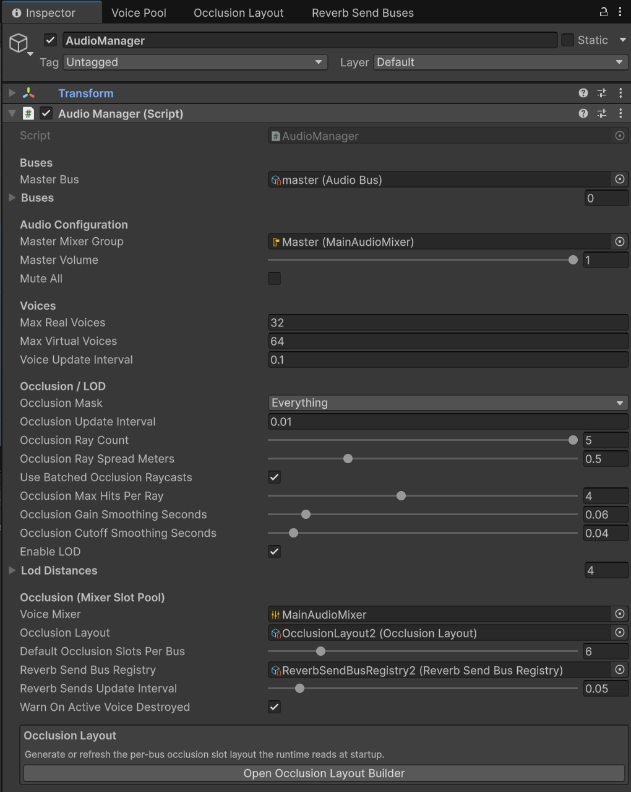
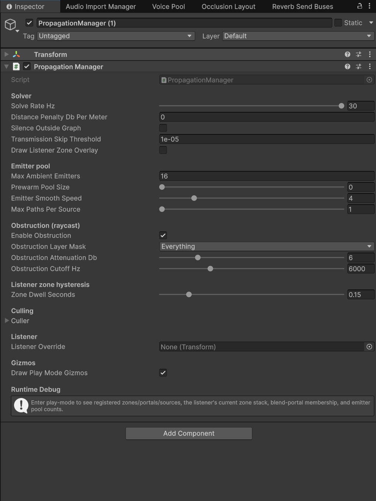
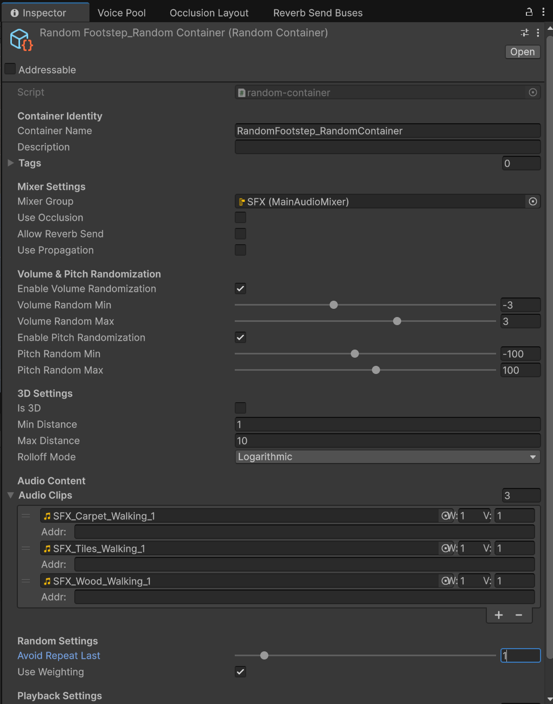
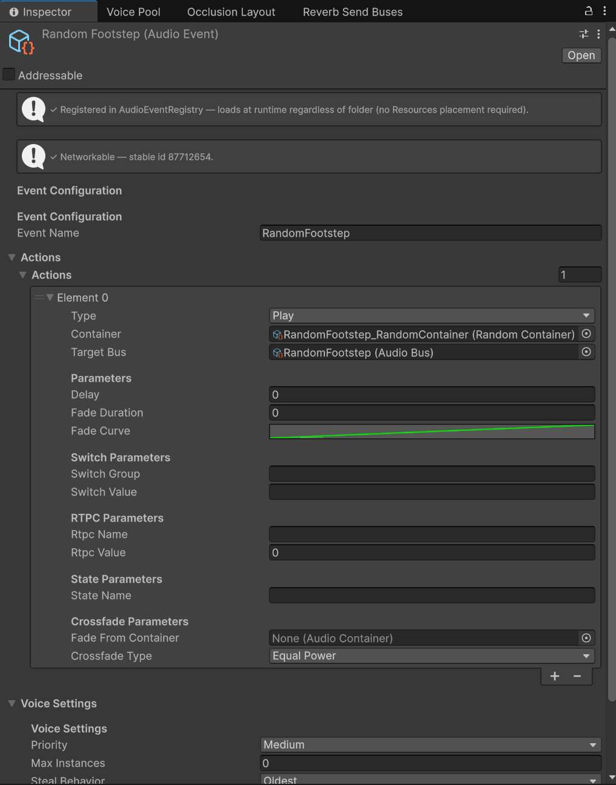
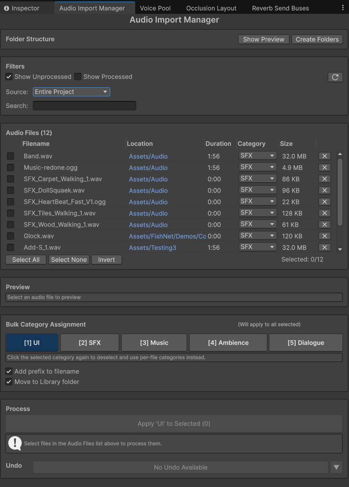

# Pepper.SFX

**Free audio middleware for Unity: events, containers, buses, states and parameters, a voice pool, split screen, occlusion, per-zone reverb and ambient propagation. Sound designers build sounds as assets; your code plays them with one call.**

<!-- Optional: hero screenshot or short demo gif. Sound Builder (Simple), the Audition window
     or a scene gizmo of zones/portals would all work well here. -->

> ℹ️ **This is the free version**: everything a single-player game needs, shipped as compiled DLLs. A **full version** is coming soon to the Unity Asset Store: it adds the C# source, multiplayer, Addressables loading, vehicle engines and more editor windows, and a free upgrade tool will move your project across without losing anything you built. See [peppersfx.com](https://peppersfx.com/get/).

## Why this exists

Unity's built-in audio is fine for a "play a sound at a position" project. Real games need more: variations that don't sound repetitive, levels you can mix across dozens of buses, reverb that changes per room, ambient sounds that come through doors and windows, and a workflow that lets sound designers iterate without touching code.

**Pepper.SFX** is the layer between your game logic and Unity's audio that makes those things easy. Sounds are played through **events**, organized in **containers**, mixed through **buses**, shaped by **parameters** and **states**, and (optionally) routed through a **zone and portal graph** so they travel through your level's geometry.

### Before

```csharp
public AudioClip footstepClip;
public AudioSource audioSource;

void PlayFootstep()
{
    audioSource.clip = footstepClip;
    audioSource.Play();
}
```

❌ No variations · ❌ Manual pooling · ❌ No mix structure · ❌ No spatialisation logic

### After

```csharp
public AudioEvent footstepEvent;

void PlayFootstep()
{
    footstepEvent.Post(gameObject, transform.position);
}
```

✅ Built-in variations · ✅ Automatic pooling · ✅ Hierarchical mixing · ✅ Spatial routing comes free

---

## Highlights

### 🎵 Core
- **Events and containers**: Random (weighted, avoids repeats), Sequence (Forward, Reverse, PingPong, Random), Switch (picked by a switch, or by a parameter's ranges), Blend (crossfades layers along a parameter, with regions and pitch that follows it) and Routing (layers that play together).
- **Buses**: a tree of levels with mute, solo, pause and a voice cap per bus; ducks that combine (the deepest one wins); a bus's level and filters following a parameter; a player volume; Unity AudioMixer integration.
- **Parameters and states**: Parameter assets with a range and smoothing, set for the whole game, per Audio Emitter or per sound; Distance, Approach Speed and Angle worked out for you; curves on every container, layer and bus; states that move buses, switches and parameters together.
- **A voice pool for busy scenes**: priorities; stealing that ends a whole sound with a short fade instead of a click; virtual voices that keep their place and come back in step; Persistent sounds that are never stolen; limits and cooldowns per event and per emitter.
- **Multi-position audio**: one sound playing from many places at once (a river, a row of speakers), in sync.
- **Clip warming**: load a clip's audio data before its first play (`WarmClip` / `WarmContainer`), so streamed music and compressed dialogue don't hitch on their first note.

### 🌍 Spatial audio
- **Attenuation assets**: distance curves for level and filters, shared between sounds.
- **Listening points and split screen**: several listeners at once. In Pepper's spatial mode, Pepper pans and fades each sound from all of them, with its own Doppler.
- **Occlusion**: walls muffle sound through mixer slots, with no clicks and no per-source filter hacks. Several rays give smooth changes across a wall's edge instead of on/off steps.
- **Per-zone reverb**: every space has its own reverb, and sounds send to the room they're played in. Convolution reverb too, on 64-bit Windows.
- **Ambient propagation**: zones and portals route long ambient beds (rain, wind, machinery) through real geometry. Rain heard *from the window* when you're in another room; doors that move smoothly between muffled and clear.
- **Soft zone boundaries**: reverb and level fade across a zone's edge instead of switching at it.

---

## 🛠️ The editor windows

Everything lives under `Window ▸ PepperSFX`, grouped by what it's for (the Menu column). In the order you'll likely meet them:

| Window | Menu | What it does for you |
|---|---|---|
| **Welcome** | Setup | Opens by itself the first time (and after each update): adds an Audio Manager to your scene, opens Sound Builder (Simple), shows the code to play a sound, and links to the guides. |
| **Sound Builder (Simple)** | Authoring | From audio files to a playable sound: creates the bus, container and event and wires them together. The fastest way to your first sound (it used to be the Quick Sound Setup Wizard). |
| **Import Manager** | Setup | Pick a category (SFX, Music, UI, Dialogue…) and the right Unity import settings are applied. **Folder Rules** give every clip first imported into a folder that folder's settings, so nobody fiddles with compression per file. |
| **Audio Explorer** | Authoring | Every event, container and bus in one browsable window: click to inspect, press play to preview. |
| **Audition** | Authoring | Plays a sound or an event while you edit it, outside Play mode: a slider for every parameter it reads, its switch values, sweeps (RPM 900 → 7000 over 4 s), and each layer's level and pitch. Tune an engine by ear without driving the car. |
| **Live View** | Debug | In Play mode, what every Audio Emitter is doing: its values, its sounds, each voice's level and pitch, and why a voice went virtual. Record one emitter, then replay it in the Audition to tune the mix on a real lap. |
| **Voice Pool Debug** | Debug | A live table of everything playing, real and virtual, with why each virtual one is. Your first stop when something *sounds* wrong. |
| **Container Validator** | Authoring | Checks every container and event for authoring mistakes (empty or zero-weight entries, a Blend with silent gaps, a Play action with no bus) and fixes them, with Undo. Run it before a build. |
| **Loop Analysis** | Engines | Measures a loop: whether it clicks where it goes round, the level across the seam, RMS, peak and loudness (LUFS), and an engine loop's pitch and RPM. |
| **Occlusion Layout** | Mixing | One-click setup for occlusion: builds the mixer slots that wall-muffling needs. Run it once, forget it exists. |
| **Reverb Send Buses** | Mixing | Create and manage per-room reverb from one overview, without hand-editing the mixer. |
| **Audio Event IDs** | Multiplayer | Gives each event a permanent, rename-proof ID and flags duplicates. |
| **Toggle Icon Overlays** | Setup | Puts audio-type icons on your assets in the Project window. |

Plus **custom inspectors with live diagnostics** on `AudioZone`, `AudioPortal`, `PropagationManager`, `ReverbSendBus` and `AudioManager` (including a live voice-pool readout while playing), and an icon for every asset and component.

---

## Documentation

Three guides come in [`Documentation~/`](https://github.com/IamAmirPepper/Pepper.SFX_System/tree/main/Documentation~), and the same ones are online at [peppersfx.com/docs](https://peppersfx.com/docs/). Each says at its top which version it documents.

- **[USER_GUIDE.md](https://github.com/IamAmirPepper/Pepper.SFX_System/tree/main/Documentation~/USER_GUIDE.md)**: Introduction, Quick Start, Cookbook, Manual, Migration and Build Compatibility.
  - **Quick Start**: your first sound playing in a few minutes.
  - **Cookbook**: recipes for footsteps, UI sounds, weapons, music, 3D audio, states and parameters, occlusion, per-zone reverb, ambient propagation and debugging.
  - **Manual**: every subsystem, chapter by chapter.
- **[API_REFERENCE.md](https://github.com/IamAmirPepper/Pepper.SFX_System/tree/main/Documentation~/API_REFERENCE.md)**: every public type, method, property and inspector field.
- **[BETA_KNOWN_ISSUES.md](https://github.com/IamAmirPepper/Pepper.SFX_System/tree/main/Documentation~/BETA_KNOWN_ISSUES.md)**: what's known not to work yet, and what changed since 3.0.0.

---

## Install

**Requirements**: Unity 6000.0.48f1 or newer, and Git installed (Unity's Package Manager fetches the package from Git).

1. **Window → Package Manager → + → Install package from git URL**
2. Paste:
   ```
   https://github.com/IamAmirPepper/Pepper.SFX_System.git
   ```
3. Done. The package appears as "Pepper's SFX System" in the Package Manager.

To install a particular version, add its tag to the URL, for example `https://github.com/IamAmirPepper/Pepper.SFX_System.git#v3.1.0`. Versions are tagged from 3.1.0 on.

Then follow the Quick Start in the User Guide: add an Audio Manager to your scene and make your first sound with Sound Builder (Simple).

---

## Free vs Full

| | **Free (this package)** | **Full (Unity Asset Store, coming soon)** |
|---|---|---|
| Events, containers, buses, states, parameters | ✅ | ✅ |
| Voice pool, virtual voices, priorities | ✅ | ✅ |
| Attenuation, listening points, split screen, Doppler | ✅ | ✅ |
| Occlusion, per-zone reverb, convolution reverb (64-bit Windows), ambient propagation | ✅ | ✅ |
| Multi-position audio | ✅ | ✅ |
| Editor windows (table above) | ✅ | ✅ + **Sound Builder (Advanced)**, **Mixer**, **Audio Profiler**, **EQ Spectrum Visualizer**, **Loading Validator**, **Addressable Audio Authoring** |
| **Vehicle engines**: the Engine Builder, the Loop Engine, and engines generated live from a sweep (Unity 6000.3+ for the Loop Engine and the generated engines) | — | ✅ |
| **Multiplayer audio**: FishNet v4, Mirror 96 or newer (new), and Netcode for GameObjects 2.x (lightly tested so far) | — | ✅ |
| **Addressables loading**, with banks per zone | — | ✅ |
| Source code | Compiled DLLs | ✅ Full C# source, and example scripts |

**Moving to full.** Free and full can't sit in the same project, so when the full version is out, a free upgrade package will do the move: install it, remove free, import full, and run **Window ▸ PepperSFX ▸ Setup ▸ Upgrade From Free**. It rewrites every script reference once, so nothing you build in free is lost.

---

## What's new

- **3.1.2** (18 November 2026): nothing changes in free; the guides are brought up to date. New in the full version: the **Loop Engine**, which plays a car's engine loops without the pitch changing how big the car sounds.
- **3.1.1** (17 November 2026): every menu is under **PepperSFX**, in categories (Window, Create, Add Component, Tools), and a **Welcome** window with the first steps opens once.
- **3.1.0** (14 November 2026):
  - 🎮 **Split screen**: listening points, and a spatial mode where Pepper pans and fades sounds from several listeners itself, with its own Doppler.
  - 🎚️ **Parameters per object**: Parameter assets with smoothing, set for the whole game, per Audio Emitter or per sound; curves on every container, Blend layer and bus; Distance, Approach Speed and Angle built in; switches driven by a parameter; Blends laid out in regions.
  - 🔊 **Mixing**: ducks that combine, pausing a bus, a voice cap per bus, a player volume, and states that move buses by an offset.
  - 🧠 **A smarter voice pool**: whole sounds stolen with a short fade instead of a cut, virtual voices that come back in step at any pitch, limits and cooldowns per emitter, and Persistent events.
  - 🛠️ **New windows**: the Audition, the Live View with recording, and Loop Analysis. The Quick Sound Setup Wizard is now Sound Builder (Simple), and the Import Manager has Folder Rules.
  - 🖼️ **Icons** for every asset and component.
  - ⚠️ **Some behaviour changed since 3.0.0.** Each change, and what to do about it, is in [BETA_KNOWN_ISSUES.md](./Documentation~/BETA_KNOWN_ISSUES.md) under "Changes since 3.0.0".

Every change, version by version: [CHANGELOG.md](./CHANGELOG.md) (entries marked "full version" aren't in this package).

---











---

## License

**Free for any game, commercial or not, with no royalties.** You can't resell or re-upload the package itself, or put it inside an asset made for other developers. See [LICENSE.txt](./LICENSE.txt). The convolution reverb plugin includes MIT-licensed code; its notices are in [Third-Party Notices.txt](./Third-Party%20Notices.txt).

For anything the license doesn't cover, contact the author below.

---

## Author

**Amir Pepper**
[amirpepper96@gmail.com](mailto:amirpepper96@gmail.com)
[github.com/IamAmirPepper](https://github.com/IamAmirPepper)
[peppersfx.com](https://peppersfx.com)


## Images

[](https://unity.com/)
[](./package.json)
[](./LICENSE.txt)
[](https://github.com/IamAmirPepper/Pepper.SFX_System/tree/main/Documentation~)
[](https://peppersfx.com)
